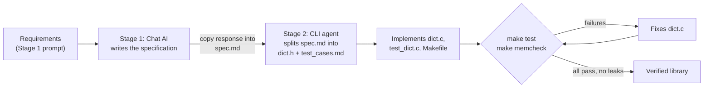

# Multi-Stage AI Workflow: String Dictionary in C (Chat → CLI)

## Overview

This workflow builds a string-to-string dictionary library in C, implemented as a hash table with separate chaining (linked lists), by chaining two AI tools from different UX categories:

| Stage | UX type | Tool used | Role |
|-------|---------|-----------|------|
| 1 | Chat | Claude | Turns plain-English requirements into a precise specification: a C header (`dict.h`) and a list of test cases (`test-cases.md`) |
| 2 | CLI | Claude Code | Implements the library against the specification, writes the tests and build file, then compiles, tests and fixes the code until every test passes with no memory leaks |

The only manual step between the two stages is copying the chat response into one file.

## Why this problem

A dictionary in C is small enough to finish in one session but has many interdependent parts: hashing, collision chains, insert/update, lookup, removal from any position in a chain, resizing, iteration and manual memory management. Mistakes are easy to make and objective to detect (compiler errors, failing tests, Valgrind leak reports), which makes it a good test of whether a multi-stage AI workflow produces correct output without human fixes.

## Workflow diagram



## Repository structure

```
/ai-workflow
  README.md
  /prompts
    01-chat-spec.md       Stage 1 prompt
    02-cli-implement.md   Stage 2 prompt
  spec.md                 Stage 1 output (the handoff)
  dict.h                  Public API, extracted from spec.md
  test-cases.md           Test cases, extracted from spec.md
  dict.c                  Implementation (Stage 2 output)
  test_dict.c             Test program (Stage 2 output)
  Makefile                Build, test and memcheck targets
  /logs
    test.log              Final test results
    memcheck.log          Final Valgrind results
  /screenshots            Chat and CLI sessions
```

## Design decisions

These decisions are fixed in the Stage 1 prompt so the specification leaves nothing open to interpretation:

- **Keys and values** are null-terminated strings.
- **Ownership:** the dictionary stores its own copies of keys and values and frees them on removal and destruction.
- **Duplicate keys:** inserting an existing key replaces its value.
- **Hashing:** djb2.
- **Resizing:** the bucket count doubles when the load factor exceeds 0.75.

## How to run the workflow

### Prerequisites

- Access to any chat-based AI
- Any CLI-based AI agent that can read and write files and run terminal commands
- `gcc`, `make` and `valgrind` installed (Linux, macOS with Valgrind support, or WSL on Windows)

### Stage 1: Generate the specification (Chat)

1. Open a new chat in your chat AI.
2. Paste the full contents of `prompts/01-chat-spec.md` and send it.
3. Copy the entire response into a new file named `spec.md` in the project folder.

The prompt requires the response to contain exactly two sections, each starting with `## FILE: <filename>`. This fixed format is the contract between the two stages.

### Stage 2: Implement and verify (CLI)

1. Open a terminal in the project folder and start the CLI agent.
2. Give it this instruction:

   ```
   Follow the instructions in prompts/02-cli-implement.md
   ```

3. Approve file creation and command execution when the agent asks. The agent will:
   1. Split `spec.md` into `dict.h` and `test_cases.md`, and confirm the header compiles on its own.
   2. Write `dict.c`, `test_dict.c` and the `Makefile`.
   3. Run `make test` and `make memcheck`, fixing `dict.c` until both pass.

### Verify the result yourself

Rerun the checks independently of the agent and save the logs:

```bash
make clean
make test | tee logs/test.log
make memcheck 2>&1 | tee logs/memcheck.log
```

A successful run ends with `SUMMARY: N/N passed` and a Valgrind report showing no leaks and no errors.

## Prompts

Both prompts are stored as plain files in `/prompts` rather than typed into a tool, so the workflow can be repeated and moved between tools.

- **`01-chat-spec.md`** describes the dictionary's requirements and the exact output format: a compilable header with documented functions, and numbered test cases covering normal use, duplicates, missing keys, NULL inputs, removal from the head, middle and tail of a chain, resizing and cleanup.
- **`02-cli-implement.md`** tells the agent to extract the two files from `spec.md`, implement the library without modifying `dict.h`, write a framework-free test program that reports PASS/FAIL per test and exits with a non-zero status on failure, and loop on testing and fixing. It forbids weakening the tests to make them pass.

## Adaptability

The workflow does not depend on a particular tool or model:

- The handoff is a plain Markdown file with a fixed structure, which any chat AI can produce and any CLI agent can read.
- Both prompts are tool-neutral; the only tool-specific part is the one-line instruction that starts Stage 2.
- Verification relies on standard tools (`gcc`, `make`, `valgrind`), not on any AI judging its own work.

_[If tested: "Stage 1 was also run with [second chat AI]; the resulting spec.md worked in Stage 2 without changes."]_

## Efficiency

| | Manual | With this workflow |
|---|---|---|
| Time to working, leak-free library | _[estimate, e.g. 3–5 hours]_ | _[actual, e.g. 15 minutes]_ |
| Manual steps | Write header, implement, write tests, debug, check for leaks | Send one prompt, paste one file, give one instruction |
| Debugging | Manual, with Valgrind output read by hand | Automated test-and-fix loop |

## Results

- **Tests:** _[e.g. 18/18 passed]_
- **Valgrind:** _[e.g. no leaks, 0 errors]_
- **Fix iterations in Stage 2:** _[e.g. 2: a leak in remove and an off-by-one in resize]_

See `/logs` for full output and `/screenshots` for both sessions.

## Problems encountered and fixes

_[Describe anything that broke and how you fixed it at the source, e.g. "The first spec did not define what get() returns for a missing key, so the CLI agent guessed. I added an explicit requirement to the Stage 1 prompt."]_

## Limitations

- Keys and values are strings only; generic types are not supported.
- The library is not thread-safe.
- The copy step between stages is manual. It could be automated, but it is a single paste and was kept manual for simplicity.
- Valgrind is not natively available on Windows; use WSL there.
